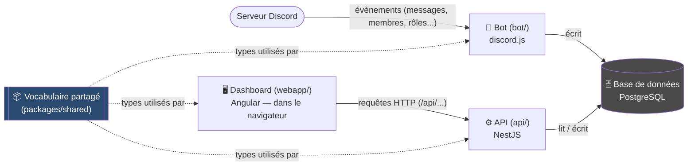
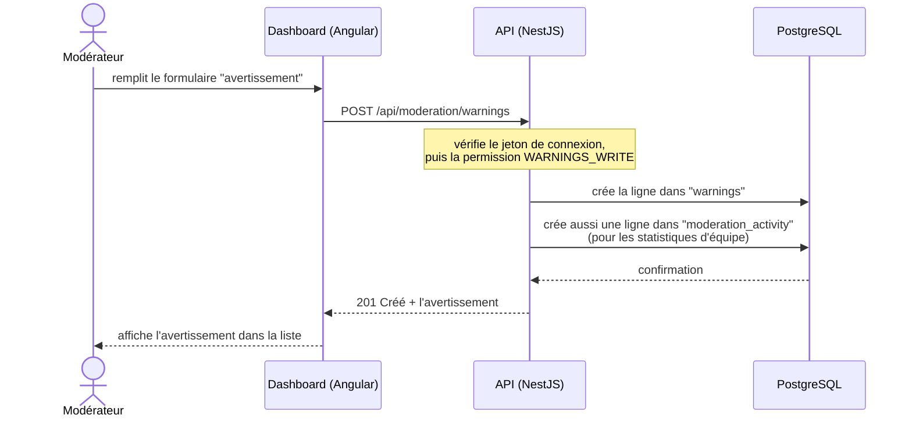
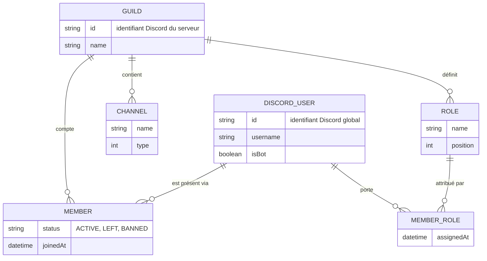
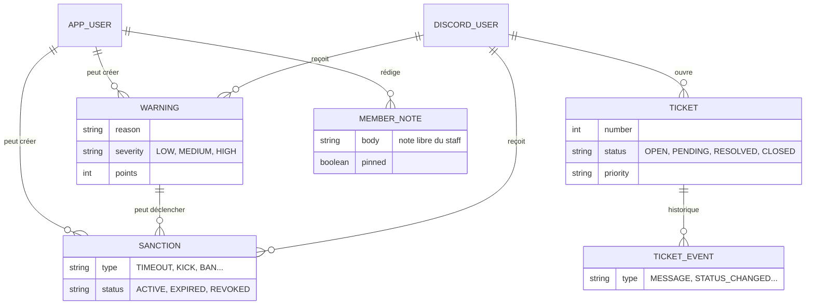
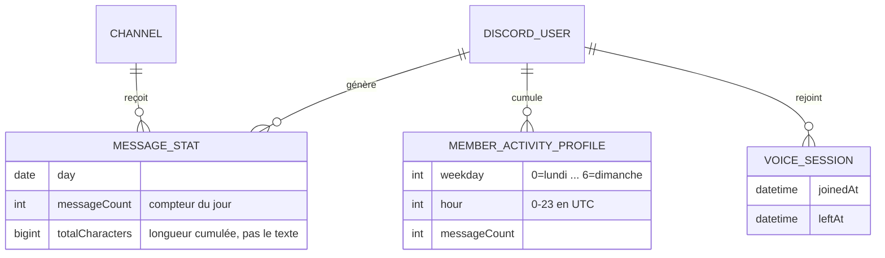
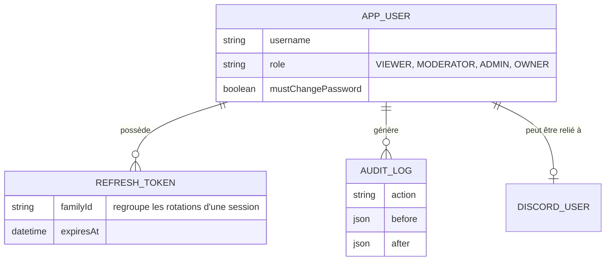
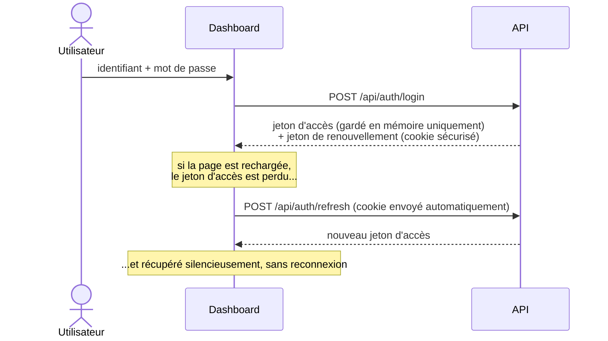
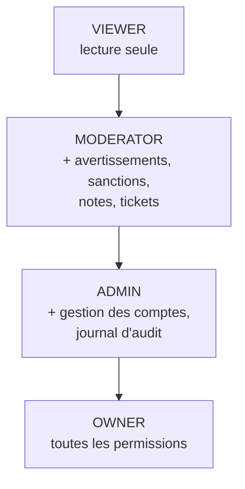

# Architecture d'Anubis

Ce document explique **comment le projet est construit**, indépendamment de
ce qu'il fait. Il s'adresse à toute personne qui ouvre le dépôt pour la
première fois — développeur ou non. Pour les instructions de démarrage
(installer, lancer, configurer), voir [`README.md`](./README.md). Pour les
pièges connus du dépôt, voir [`CLAUDE.md`](./CLAUDE.md).

> **Anubis en une phrase** : un bot Discord observe un serveur et enregistre
> ce qui s'y passe dans une base de données ; un site web (le "dashboard")
> permet à l'équipe de modération de consulter ces données et d'agir
> (avertissements, sanctions, tickets de support).

---

## 1. Vue d'ensemble

Le projet est composé de **quatre briques**, dans un seul dépôt (on appelle
ça un *monorepo*) :

```
anubis/
├─ bot/               Bot Discord — observe le serveur, écrit en base
├─ api/               API — seule brique autorisée à parler à la base
├─ webapp/            Dashboard — site web consulté par l'équipe
└─ packages/shared/   Vocabulaire commun aux trois briques ci-dessus
```

La règle la plus importante du projet tient en une phrase : **le dashboard
ne parle jamais directement à la base de données**. Il passe toujours par
l'API. C'est l'API seule qui détient les identifiants PostgreSQL.



Pourquoi cette séparation ? Parce que **le navigateur d'un utilisateur ne
doit jamais connaître le mot de passe de la base de données**. Le navigateur
ne parle qu'à l'API, en HTTP, avec un jeton de connexion (voir
[§5](#5-authentification--permissions)). Seule l'API et le bot, qui tournent
sur un serveur de confiance, ont accès direct à PostgreSQL.

---

## 2. Les quatre briques, en détail

### 2.1 `packages/shared` — le vocabulaire commun

**Rôle** : définir une seule fois chaque type de donnée (« à quoi ressemble
un avertissement », « quelles sont les valeurs possibles d'un statut de
ticket »...), pour que le bot, l'API et le dashboard ne divergent jamais.

C'est la brique la plus particulière du projet : elle a **deux portes
d'entrée séparées**, parce qu'une partie de son contenu ne doit jamais
atteindre le navigateur.

| Point d'entrée | Contenu | Qui peut l'importer |
|---|---|---|
| `@anubis/shared` | Types TypeScript, enums, permissions — **aucune dépendance** | Bot, API **et** dashboard (navigateur inclus) |
| `@anubis/shared/prisma` | Le client de base de données généré par Prisma | Bot et API **uniquement**, jamais le navigateur |

```
packages/shared/
├─ src/
│  ├─ enums.ts         valeurs possibles (statuts, sévérités, rôles...)
│  ├─ permissions.ts    qui a le droit de faire quoi
│  ├─ dto/              forme des données échangées avec l'API
│  ├─ discord.ts        types utilitaires liés à Discord
│  └─ index.ts          point d'entrée public (sans Prisma)
├─ prisma/
│  ├─ schema.prisma      LE plan de la base de données (source de vérité)
│  ├─ migrations/        historique des changements appliqués à la base
│  └─ seed.ts            script qui crée les données de départ
└─ generated/            client Prisma généré automatiquement (jamais modifié à la main)
```

> Si un jour une fonctionnalité doit changer une donnée, c'est **toujours
> ici** que ça commence : `schema.prisma` d'abord, puis les types dans
> `src/dto/`, puis les permissions si besoin.

### 2.2 `api/` — le seul gardien de la base de données

**Rôle** : recevoir les requêtes du dashboard, vérifier que l'utilisateur a
le droit de faire ce qu'il demande, lire ou écrire en base, renvoyer une
réponse. Construite avec **NestJS** (un framework qui organise le code en
petits blocs spécialisés).

```
api/src/
├─ auth/           connexion, jetons, changement de mot de passe
├─ app-users/       gestion des comptes du dashboard (staff)
├─ members/         fiches des membres du serveur Discord
├─ moderation/       avertissements, sanctions, notes internes
├─ tickets/          tickets de support
├─ stats/            chiffres agrégés pour les graphiques
├─ audit/            qui a fait quoi, et quand
├─ common/           guards, filtres d'erreurs, décorateurs partagés
├─ prisma/           connexion à la base (via packages/shared/prisma)
├─ config/           lecture des variables d'environnement
├─ app.module.ts      assemble tous les modules ci-dessus
└─ main.ts            point de démarrage du serveur
```

Chaque dossier (« module ») suit toujours le même trio de fichiers :

| Fichier | Rôle |
|---|---|
| `*.controller.ts` | Reçoit la requête HTTP, appelle le service, renvoie la réponse |
| `*.service.ts` | Contient la vraie logique (règles métier, accès base) |
| `*.module.ts` | Déclare quel controller va avec quel service |
| `dto/*.ts` | Décrit la forme attendue d'une requête entrante (validée automatiquement) |

### 2.3 `webapp/` — le site web consulté par l'équipe

**Rôle** : afficher les données (tableaux, graphiques, fiches membres) et
permettre d'agir (créer un avertissement, répondre à un ticket...).
Construit avec **Angular** et sa bibliothèque de composants **Material**.

```
webapp/src/app/
├─ core/             services transverses : appel API, authentification
│  ├─ api/            une méthode = un appel HTTP vers l'API
│  └─ auth/            gestion du jeton de connexion
├─ features/         un dossier par écran (dashboard, membres, tickets...)
├─ layout/           l'ossature visuelle commune (menu, en-tête)
└─ shared/           composants et graphiques réutilisables entre écrans
```

Le dashboard **ne fait aucune règle de sécurité** : il peut cacher un bouton
si l'utilisateur n'a pas la permission, mais si quelqu'un contourne
l'interface, c'est l'API qui refusera la requête. L'interface n'est qu'un
confort, jamais une barrière.

### 2.4 `bot/` — les yeux du serveur Discord

**Rôle** : rester connecté au serveur Discord, réagir à ce qui s'y passe
(nouveau message, membre qui part, rôle modifié...) et l'écrire en base.
Écrit en **JavaScript** (pas TypeScript), avec **discord.js**.

```
bot/
├─ index.js           point de démarrage : connexion à Discord
├─ events/            un fichier par type d'évènement Discord
├─ commands/          commandes tapées par les utilisateurs (ex: /rank)
├─ src/collectors/     logique de collecte, regroupée par thème
│  ├─ referentiel.js   serveur, rôles, salons, membres, historiques
│  └─ activite.js       compteurs de messages
└─ utils/             fonctions utilitaires, constantes
```

Particularité notable : **`bot/` n'est pas géré par npm workspaces** comme
les trois autres briques (voir [`CLAUDE.md`](./CLAUDE.md) pour le détail
technique — en résumé, une de ses dépendances contient du code compilé qui
casserait si on la réinstallait globalement).

Le bot fonctionne en deux temps complémentaires :

1. **Synchronisation complète au démarrage** — relit tout l'état du serveur
   Discord pour rattraper ce qui a changé pendant que le bot était éteint.
2. **Évènements en continu** — réagit en temps réel à chaque changement une
   fois démarré.

---

## 3. Un exemple de bout en bout : créer un avertissement

Pour rendre l'architecture concrète, voici le trajet complet d'une action
typique de modération, de la souris jusqu'à la base de données.



Ce même schéma s'applique à toute action du dashboard : la requête entre
toujours par l'API, jamais directement par la base.

---

## 4. Le modèle de données

La base de données a quatre grandes familles de tables. Voici chacune sous
forme de schéma simplifié (les champs techniques comme les dates de création
sont omis pour la lisibilité — le détail exact vit dans
`packages/shared/prisma/schema.prisma`).

### 4.1 Référentiel Discord — "qui est qui sur le serveur"



`DiscordUser` est un compte Discord global (indépendant d'un serveur en
particulier) ; `Member` est sa **présence sur ce serveur précis**. Cette
distinction permet de garder l'historique d'un utilisateur même après son
départ.

### 4.2 Modération — avertissements, sanctions, tickets



Une sanction peut naître d'un avertissement (`Sanction.warningId`), mais ce
n'est pas obligatoire — un modérateur peut sanctionner directement.

### 4.3 Activité — des agrégats, jamais le contenu des messages



**Choix volontaire du projet** : le bot ne stocke jamais le texte des
messages, seulement des compteurs par jour et par créneau horaire. C'est
suffisant pour tous les graphiques d'activité, et évite d'accumuler des
données personnelles sensibles.

### 4.4 Comptes du dashboard — qui peut se connecter au site



Un compte du dashboard (`AppUser`, une personne du staff avec un mot de
passe) est **totalement distinct** d'un `DiscordUser` (un compte Discord).
Le lien entre les deux est facultatif.

---

## 5. Authentification & permissions

### 5.1 Se connecter

Il n'existe **aucune inscription publique** : un compte se crée uniquement
depuis le dashboard par un administrateur, qui transmet un mot de passe
provisoire à usage unique.



Le jeton d'accès n'est **jamais** écrit dans `localStorage` : un script
malveillant injecté dans la page ne peut donc pas le voler. Le jeton de
renouvellement, lui, vit dans un cookie que JavaScript ne peut pas lire, et
il change à chaque utilisation — le rejouer une deuxième fois invalide toute
la session.

### 5.2 Qui a le droit de faire quoi

Les droits ne sont **jamais** codés en dur par rôle dans le code (pas de
`if (role === 'ADMIN')` disséminé) : chaque action correspond à une
**permission** nommée, et un rôle n'est qu'une liste de permissions.



Chaque rôle hérite des permissions du rôle précédent. Cette liste vit à un
seul endroit : `packages/shared/src/permissions.ts` — c'est le fichier à
modifier pour ajouter un droit, jamais un `if` isolé dans un service.

---

## 6. Types de fichiers du projet

Un même dépôt mélange plusieurs langages et formats. Voici comment les
reconnaître :

| Extension / fichier | Signification | Où on le trouve |
|---|---|---|
| `.ts` | TypeScript (JavaScript + vérification de types) | `api/`, `webapp/`, `packages/shared/` |
| `.js` | JavaScript pur, sans vérification de types | `bot/` uniquement |
| `.html` | Modèle visuel d'un écran (template Angular) | `webapp/src/app/**` |
| `.scss` | Feuille de style (CSS avec des variables et fonctions) | `webapp/src/app/**` |
| `.prisma` | Plan de la base de données (tables, colonnes, relations) | `packages/shared/prisma/schema.prisma` |
| `migration.sql` | Instructions SQL générées pour faire évoluer la base | `packages/shared/prisma/migrations/**` |
| `.json` | Configuration (dépendances, compilateur, outils) | `package.json`, `tsconfig.json`, `angular.json`... |
| `.env` / `.env.example` | Variables sensibles (mots de passe, clés) — jamais commité pour `.env` | racine de chaque brique |
| `.md` | Documentation lisible par un humain | ce fichier, `README.md`, `CLAUDE.md` |

Conventions de nommage à connaître côté `api/` (NestJS) :

- `xxx.module.ts` — assemble un morceau de fonctionnalité
- `xxx.controller.ts` — reçoit les requêtes HTTP
- `xxx.service.ts` — contient la logique
- `xxx.dto.ts` (dans un dossier `dto/`) — décrit la forme d'une donnée échangée
- `xxx.guard.ts` — vérifie une condition avant de laisser passer une requête (ex : "l'utilisateur est-il connecté ?")

Côté `webapp/` (Angular), un écran ou composant est presque toujours un trio
de fichiers portant le même nom : `xxx.ts` (logique), `xxx.html` (visuel),
`xxx.scss` (style).

---

## 7. Commandes utiles

| Commande | Effet |
|---|---|
| `npm run dev` | Démarre l'API et le dashboard en parallèle |
| `npm run build` | Compile `packages/shared`, puis `api/`, puis `webapp/` — la meilleure façon de détecter une erreur avant de livrer |
| `npm run db:generate` | Régénère le client de base de données après une modification de `schema.prisma` |
| `npm run db:migrate` | Crée une migration à partir du schéma (développement) |
| `npm run db:deploy` | Applique les migrations existantes à la base |
| `npm run db:seed` | Crée le compte propriétaire (`-- --demo` pour des données d'exemple) |
| `npm run db:studio` | Ouvre un explorateur visuel de la base de données |

---

## 8. Glossaire

| Terme | Signification |
|---|---|
| **Monorepo** | Un seul dépôt Git qui contient plusieurs projets liés entre eux |
| **API (Application Programming Interface)** | Le programme qui répond aux requêtes du dashboard et qui seul parle à la base |
| **ORM** | Un outil qui traduit des tables de base de données en objets manipulables dans le code (ici : **Prisma**) |
| **Migration** | Un fichier qui décrit un changement à appliquer à la structure de la base de données |
| **DTO (Data Transfer Object)** | La forme exacte attendue ou renvoyée par une requête (ex : "un avertissement a une raison en texte et une sévérité") |
| **Enum** | Une liste fermée de valeurs possibles (ex : un statut de ticket ne peut être que OPEN, PENDING, RESOLVED ou CLOSED) |
| **Guard** | Un contrôle exécuté avant qu'une requête n'atteigne son traitement (ex : vérifier le jeton de connexion) |
| **Jeton (token)** | Une chaîne de caractères qui prouve qu'un utilisateur est connecté, sans renvoyer son mot de passe à chaque requête |
| **Standalone component / signal** | Deux mécanismes récents d'Angular pour organiser l'interface sans configuration superflue |
